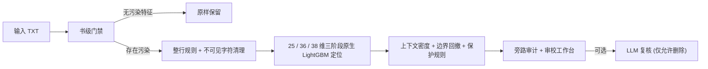

# adclean

[](https://github.com/Nanoda16/adclean/actions/workflows/ci.yml)
[](https://www.python.org/)
[](LICENSE)

一个本地运行的中文小说 TXT 广告清理与可审计校对工具。

很多网上流传的小说 TXT 并不是只在段尾加一行网址，而是把广告拆散成单字，混着同音字、异体字、生僻字、日文假名、零宽字符和特殊符号插进正常句子里：

```text
原文: “源川桑还是一位作家奇‎弍‍冷师‍企​散‌斯吗？”
清理: “源川桑还是一位作家吗？”

原文: 可没想到樱峮-酒零!柳4溜7/芭岛麻衣却摇了摇头
清理: 可没想到樱岛麻衣却摇了摇头
```

这类穿插广告没有固定关键词，正则替换基本无解，所以写了这个基于局部上下文搭配的逐字定位与人工校对工具。处理原则是**只删不改写句子**（默认会先做一次繁转简统一字形，可在界面或用 `--no-simplify` 关闭），全程本地执行，不覆盖原文件。

## 实测效果

在训练集外的合成污染样本（27.2 万字，16,280 处注入，覆盖 11 种常见注入手法）上的对比结果：

| 方案 | 广告清除率 | 正文误伤率 | 精确率 |
| :--- | ---: | ---: | ---: |
| 早期句级语义模型 | 92.1% | 4.471%（约 447 字/万字） | 57.3% |
| 当前字位定位器（默认） | 89.6% | 0.754%（约 75 字/万字） | 88.5% |

正文误伤率压到了早期方案的约 1/6，专名、地名和常见词组基本不再出错。分类清除率大致如下：整行/章尾广告、不可见字符、私用区字符 100%，非 BMP 字符 98.6%，生僻水印字 91.6%，数字谐音 90.3%，装饰符号 83.8%，纯常用字水印 65.7%。

## 实现思路



- **书级门禁与整行规则**：先检查全书是否存在不可见字符、非 BMP 字符、广告行或异常稀见字密度；干净的书直接跳过。整行规则带有残余正文保护，避免误伤正文中带“QQ群：”等字样的正常对白。
- **25 / 36 / 38 维三阶段原生 LightGBM 模型**：模型以纯文本格式（`locate_m1.txt` / `locate_p1.txt` / `locate_p2.txt` + `locate_meta.json`）随包分发，加载时做 SHA-256 与特征维度校验，**不依赖 `pickle` 或 `scikit-learn`**：
  - **阶段 1（25 维）**：行级快速筛查（字符类别、局部搭配、标准化搭配、全书累积、段落语境），只保留可疑行并缓存特征切片；
  - **阶段 2（36 维）**：为可疑行补齐拼音同音、词级搭配与单双向语义特征，给出单字初判分数；
  - **阶段 3（38 维）**：将左右邻字的阶段 2 分数拼接回 36 维特征做上下文联合打分，再经过上下文异常密度（`±20` 字窗口不少于 4 处）、边界回撤（默认 `0.5`）、颜文字整组保护、字母数字完整性与白名单过滤。
- **自适应语言模型（免外部缓存可用）**：若同目录存在 `.adclean-lm-*.json` 外部语料缓存会优先加载；未提供时会自动基于当前输入文本在内存中构建 n-gram 语言模型（`auto_fit`），克隆源码后即可直接完成清洗。
- **出版校对室工作台与人工闭环**：提供暖纸墨色风格校对界面，任务完成后展示 KPI 概览、「审校清单」（支持类型/状态/关键词筛选、字符级红绿 Diff、零宽与控制符可视化标签）、右侧上下文详情抽屉（上下 2 行语境与 `A` 采纳 / `R` 撤回 / `J`/`K` 切换 / `Esc` 关闭快捷键）、底部「应用审校并重生成终稿」写盘与初稿/原文回滚、「全文对比 Diff」及单文件 / 打包 ZIP 导出。
- **可选 LLM 深度复核**：默认关闭，不配 Key 不联网。开启后可拉取模型列表并先做连通探测，仅将疑难片段发往 OpenAI 兼容接口（支持本地 Ollama / vLLM 等），且代码硬性限制 `DELETE_ONLY`，拒绝模型改写正文。

每次清洗除了输出清理后的 `.txt`，还会在输出目录附带 `.audit.json`、`.changelog.json` 和 `.review_queue.json`，方便抽查每处改动。

## 使用方法

### 1. Windows 桌面版（免配置）

去 [Releases](https://github.com/Nanoda16/adclean/releases) 下载压缩包并**完整解压**，双击 `adclean.exe` 即可打开校对工作台（支持把 `.txt` 或文件夹直接拖入窗口，或拖到 `adclean.exe` 图标上预载）。

默认使用输入文稿自适应语言模型，解压后即可直接运行；如果目录中同时放有 `.adclean-lm-*.json` 外部语料缓存，程序会自动识别并使用。

### 2. Windows 一键启动本地 Web UI（源码目录）

确保已安装 Python 3.9+ 与依赖（`numpy`、`lightgbm`），直接双击根目录下的 `start.bat`：

- 自动查找 `.venv` / `venv` / `py -3` / `python` 并在当前终端前台启动本地服务，随后自动打开浏览器；
- 关闭终端窗口或按 `Ctrl+C` 即可立即停止服务；
- 支持向 `adclean.server` 透传参数，例如在命令行执行 `start.bat --port 9000 --no-browser`。

### 3. 从源码或命令行运行

需要 Python 3.9+：

```bash
pip install -e .
# 如需启用 pywebview 原生桌面窗口（无地址栏），改用：
# pip install -e ".[gui]"

# 浏览器工作台（支持浏览器内拖拽/流式上传与本机目录浏览，与桌面拖拽体验一致）
python -m adclean.server

# 原生桌面窗口（仅需安装了 .[gui]；也支持把文件/目录路径作为参数传入）
python -m adclean

# 命令行批量处理
python -m adclean "D:\novels" -o "D:\novels_cleaned"
```

常用命令行参数：

| 参数 | 默认值 | 说明 |
| :--- | :--- | :--- |
| `-o, --out` | `./cleaned_audit` | 输出目录（自动拦截与原文件同目录覆写） |
| `--engine` | `locate` | 引擎选择：`locate`（默认）/ `semantic` / `v3` |
| `--lm` | 空 | 外部 n-gram 缓存路径（不传或不存在时自动按输入文本构建） |
| `--no-simplify` | 否 | 关闭繁转简，保留原字形 |
| `--names` | 空 | 逗号分隔的人名/专名白名单 |
| `--near-k` / `--near-w` | `4` / `20` | 上下文异常数规则阈值与窗口大小 |
| `--trim` | `0.5` | 边界回撤阈值，`0` 为关闭 |

## 开发、测试与打包

克隆仓库后可直接运行全部单元测试与前端资源检查（无需外部语料缓存）：

```bash
pip install -e ".[dev]"
python -m pytest tests -q
```

打包 Windows 独立目录版（PyInstaller `--onedir`）：

```bash
python build_exe.py
```

## 目录说明

```text
adclean/
  locate.py     # 默认 25/36/38 维三阶段原生 LightGBM 定位器
  ads.py        # 整行确定性广告规则（带残余正文保护）
  audit.py      # 只读旁路审计（生成异常区域报告）
  pipeline.py   # 主流程编排与 CLI 入口
  review.py     # 审校队列与 DELETE_ONLY 约束
  llm.py        # OpenAI 兼容接口封装（纯标准库，含 SSRF 校验）
  v2lm.py       # 纯标准库 n-gram 语言模型（支持文件缓存与内存自建）
  t2s.py        # 繁简转换（单字 + 词组级消歧）
  server.py     # 本地 HTTP 服务与审校 REST API
  gui.py        # pywebview 桌面窗口外壳
  static/       # Editorial 校对工作台前端（HTML / CSS / JS 模块）
  data/         # 拼音表、简繁表与原生 LightGBM 模型（locate_m1/p1/p2.txt）
tests/          # 单元测试与 UI 资源校验
start.bat       # Windows 单终端一键启动脚本
```

本工具仅做本地文本清理与校对，不提供或传播任何小说内容。不同书源的注入方式差异很大，建议先拿单本试跑并用审校清单抽查后再批量处理。

## License

[MIT](LICENSE)
