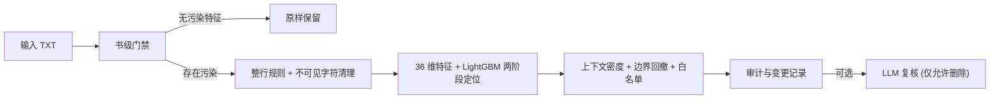

# adclean

[](https://github.com/Nanoda16/adclean/actions/workflows/ci.yml)
[](https://www.python.org/)
[](LICENSE)

一个本地运行的中文小说 TXT 广告清理工具。

很多网上流传的小说 TXT 并不是在段尾加一行网址，而是把广告拆散成单字，混着同音字、异体字、生僻字、日文假名、零宽字符和特殊符号塞进正常句子里：

```text
原文: “源川桑还是一位作家奇‎弍‍冷师‍企​散‌斯吗？”
清理: “源川桑还是一位作家吗？”

原文: 可没想到樱峮-酒零!柳4溜7/芭岛麻衣却摇了摇头
清理: 可没想到樱岛麻衣却摇了摇头
```

这类穿插广告没有固定关键词，正则替换基本无解，所以写了这个基于局部上下文搭配的逐字定位工具。处理原则是**只删不改写句子**（默认会先做一次繁转简统一字形，可用 `--no-simplify` 关闭），全程本地执行，不覆盖原文件。

## 实测效果

在训练集外的合成污染样本（27.2 万字，16,280 处注入，覆盖 11 种常见注入手法）上的对比结果：

| 方案 | 广告清除率 | 正文误伤率 | 精确率 |
| :--- | ---: | ---: | ---: |
| 早期句级语义模型 | 92.1% | 4.471%（约 447 字/万字） | 57.3% |
| 当前字位定位器（默认） | 89.6% | 0.754%（约 75 字/万字） | 88.5% |

清除率略微下降了一点，但正文误伤率压到了原来的约 1/6，早期版本容易误删的专名、地名和常见词组基本不再出错。分类清除率大致如下：整行/章尾广告、不可见字符、私用区字符 100%，非 BMP 字符 98.6%，生僻水印字 91.6%，数字谐音 90.3%，装饰符号 83.8%，纯常用字水印 65.7%。

## 实现思路



- **书级门禁**：先检查全书是否存在不可见字符、非 BMP 字符、广告行或异常稀见字密度。完全干净的书直接跳过，一个字都不动。
- **两阶段字位定位**：抽取每个字的 36 维局部特征（字符类别、前后接缝搭配、全书统计分布、拼音同音伪装度等），用 LightGBM 第一遍筛出可疑行，第二遍逐字打分并把左右邻字的分数回灌。
- **两条压误伤规则**：广告通常是成片注入的，窗口（`±20` 字）内异常字少于 4 个时不动；被标出片段的两端再用不看邻居的一遍分数复核，把握不够就撤回。同时支持传入人名/专名白名单。
- **可选 LLM 复核**：默认关闭，不配 Key 不联网。开启后只把定位器拿不准的可疑片段发给 OpenAI 兼容接口（支持本地 Ollama / vLLM 等），且代码里硬性限制只接受删除操作，拒绝模型改写正文。

每次清洗除了输出清理后的 `.txt`，还会在输出目录附带 `.audit.json`、`.changelog.json` 和 `.review_queue.json`，方便抽查每处改动。

## 使用方法

### 1. 直接用打包好的桌面版（Windows）

去 [Releases](https://github.com/Nanoda16/adclean/releases) 下载压缩包并**完整解压**，双击 `adclean.exe` 即可打开界面（也可以直接把 `.txt` 或文件夹拖到 exe 上）。

解压目录里包含一个约 101 MB 的 `.adclean-lm-a5.json` 语言模型统计缓存，和 `_internal/` 一样需要留在 exe 同级目录，不能单独把 exe 拷走。

### 2. 从源码运行

需要 Python 3.9+：

```bash
pip install -e ".[gui]"

# 打开桌面窗口（或运行 python -m adclean.server 用浏览器访问）
python -m adclean

# 命令行批量处理
python -m adclean "D:\novels" -o "D:\novels_cleaned"
```

> 由于 GitHub 限制单文件 100 MB，仓库里不包含 `.adclean-lm-a5.json`。从源码跑完整清洗时，请从 [Releases](https://github.com/Nanoda16/adclean/releases) 下载压缩包，把该文件放到项目根目录即可。

常用命令行参数：

| 参数 | 默认值 | 说明 |
| :--- | :--- | :--- |
| `-o, --out` | `./cleaned_audit` | 输出目录（自动拦截与原文件同目录覆写） |
| `--engine` | `locate` | 引擎选择：`locate`（默认）/ `semantic` / `v3` |
| `--no-simplify` | 否 | 关闭繁转简，保留原字形 |
| `--names` | 空 | 逗号分隔的人名/专名白名单 |
| `--near-k` / `--near-w` | `4` / `20` | 上下文异常数规则阈值与窗口大小 |
| `--trim` | `0.5` | 边界回撤阈值，`0` 为关闭 |

## 开发、测试与打包

测试套件不依赖 101 MB 外部缓存，克隆下来就能直接跑：

```bash
pip install -e ".[dev]"
python -m pytest tests -q
```

打包 Windows 独立目录版：

```bash
python build_exe.py
```

## 目录说明

```text
adclean/
  locate.py     # 默认两阶段 LightGBM 定位器
  ads.py        # 9 类整行确定性广告规则
  audit.py      # 只读审计旁路（生成异常区域报告）
  pipeline.py   # 主流程编排与 CLI 入口
  review.py     # 审查队列与 DELETE_ONLY 约束
  llm.py        # OpenAI 兼容接口封装（仅用标准库）
  v2lm.py       # 纯标准库 n-gram 语言模型
  t2s.py        # 繁简转换
  server.py     # 本地 HTTP 服务
  gui.py        # pywebview 窗口外壳
  static/       # 前端页面
  data/         # 拼音表、定位模型与简繁表
tests/          # 单元测试
```

本工具仅做本地文本清理，不提供或传播任何小说内容。不同书源的注入方式差异很大，建议先拿几本试跑确认效果再批量处理。

## License

[MIT](LICENSE)
